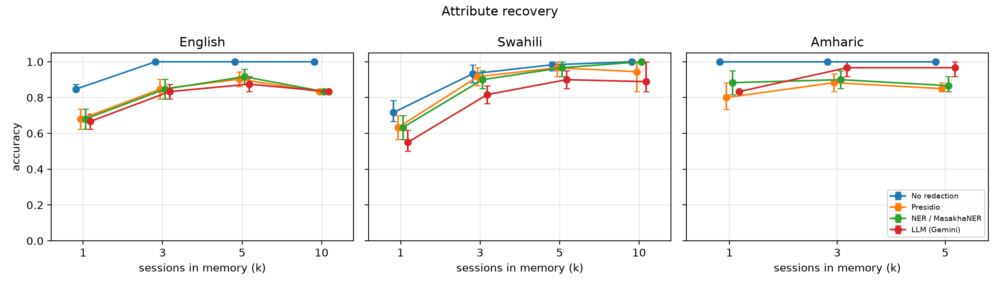
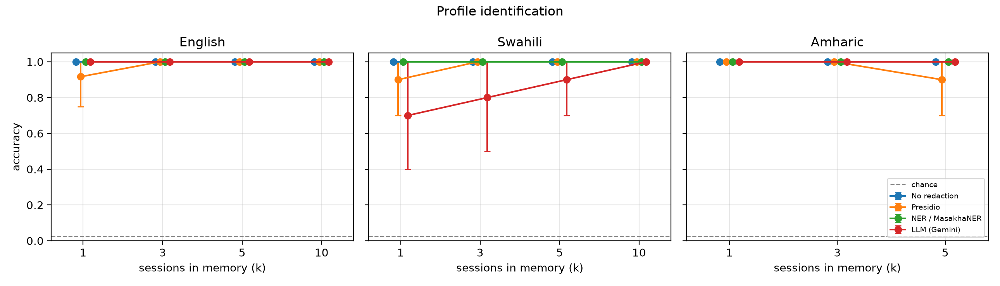

# Results

Generated 2026-11-22 07:29.
Sessions: 5 user messages each. Gemini redactor: gemini-3.1-flash-lite. Summarizer: gemini-3.1-flash-lite. Attacker: gemini-3.1-flash-lite. Candidate pool: all.

## Data

| Language | Profiles | Profiles with sessions | Sessions per profile | Sessions |
|---|---|---|---|---|
| English | 20 | 12 | 9-12 | 111 |
| Swahili | 10 | 10 | 6-18 | 106 |
| Amharic | 10 | 10 | 6-9 | 87 |

Profiles were built to overlap: 24 of 40 share their location, occupation and education with another profile, and 2 share all six attributes with another profile (Nathan Mercer, Nadia Alvarez). Such twins can only be told apart by direct identifiers that survive redaction. Details: `tables/lookalikes.csv`.

## 1. Span-level redaction (Table 1)

Reference spans are the profile's name, phone, email, national ID, city, country and neighbourhood, plus places the user searched for and coordinates the user gave, wherever they appear in the session. They are found automatically from profiles.csv and the user's messages, not annotated by hand. A span counts as found only if all its letters and digits are masked; a mask counts as correct if it overlaps a reference span.

| Language | Approach | Profiles | Reference spans | Masks | Precision [95% CI] | Recall [95% CI] | F1 [95% CI] |
|---|---|---|---|---|---|---|---|
| English | Presidio based redactor | 12 | 3252 | 3247 | 0.92 [0.89, 0.94] | 0.87 [0.83, 0.90] | 0.89 [0.87, 0.91] |
| English | NER based redactor | 12 | 3252 | 2636 | 0.90 [0.87, 0.92] | 0.68 [0.66, 0.70] | 0.77 [0.75, 0.79] |
| English | LLM Data Anonymization | 12 | 3252 | 2861 | 0.99 [0.99, 1.00] | 0.91 [0.89, 0.92] | 0.95 [0.94, 0.96] |
| Swahili | Presidio based redactor | 10 | 3084 | 2932 | 0.75 [0.72, 0.79] | 0.83 [0.76, 0.89] | 0.79 [0.75, 0.82] |
| Swahili | MasakhaNER based redactor | 10 | 3084 | 2435 | 0.70 [0.66, 0.74] | 0.66 [0.63, 0.69] | 0.68 [0.65, 0.70] |
| Swahili | LLM Data Anonymization | 10 | 3084 | 2737 | 1.00 [0.99, 1.00] | 0.94 [0.92, 0.95] | 0.97 [0.96, 0.98] |
| Amharic | Presidio based redactor | 10 | 2818 | 3062 | 0.74 [0.71, 0.77] | 0.90 [0.88, 0.93] | 0.81 [0.79, 0.84] |
| Amharic | MasakhaNER based redactor | 10 | 2818 | 2394 | 0.66 [0.63, 0.70] | 0.67 [0.64, 0.69] | 0.67 [0.64, 0.69] |
| Amharic | LLM Data Anonymization | 10 | 2818 | 2108 | 0.99 [0.98, 1.00] | 0.93 [0.92, 0.95] | 0.96 [0.95, 0.97] |

Recall by kind of identifier (share of reference spans fully masked):

| Language | Approach | Name | Phone | Email | National Id | Location | Place | Coordinates |
|---|---|---|---|---|---|---|---|---|
| English | Presidio based redactor | 92.5% | 83.5% | 100.0% | 14.6% | 93.4% | 64.4% | 0.0% |
| English | NER based redactor | 92.3% | 0.0% | 0.0% | 0.0% | 93.4% | 64.4% | 0.0% |
| English | LLM Data Anonymization | 80.1% | 100.0% | 100.0% | 100.0% | 100.0% | 97.3% | 0.0% |
| Swahili | Presidio based redactor | 98.2% | 63.8% | 100.0% | 15.2% | 87.4% | 96.8% | 0.0% |
| Swahili | MasakhaNER based redactor | 96.9% | 0.0% | 16.5% | 0.0% | 87.4% | 96.8% | 0.0% |
| Swahili | LLM Data Anonymization | 90.0% | 100.0% | 97.4% | 100.0% | 99.0% | 95.2% | 0.0% |
| Amharic | Presidio based redactor | 99.4% | 100.0% | 100.0% | 0.0% | 87.4% | 100.0% | 22.2% |
| Amharic | MasakhaNER based redactor | 99.4% | 0.0% | 22.7% | 0.0% | 87.4% | 100.0% | 22.2% |
| Amharic | LLM Data Anonymization | 89.6% | 100.0% | 100.0% | 100.0% | 96.5% | 91.5% | 0.0% |

## 2. Attribute recovery (Table 2)

Share of the six attributes (age group, location, occupation, education, family status, health condition) the attacker got right from the first k memory notes, averaged over profiles. "Unknown" counts as wrong. n/a: no profile has that many sessions yet. Profiles per cell: 1 session: English 12, Swahili 10, Amharic 10; 3 sessions: English 12, Swahili 10, Amharic 10; 5 sessions: English 12, Swahili 10, Amharic 10; 10 sessions: English 1, Swahili 3.

| Language | Approach | k | Profiles | Accuracy [95% CI] | Answered unknown |
|---|---|---|---|---|---|
| English | No redaction | 1 | 12 | 84.7% [83.3%, 87.5%] | 15.3% |
| English | No redaction | 3 | 12 | 100.0% [100.0%, 100.0%] | 0.0% |
| English | No redaction | 5 | 12 | 100.0% [100.0%, 100.0%] | 0.0% |
| English | No redaction | 10 | 1 | 100.0% | 0.0% |
| English | Presidio based redactor | 1 | 12 | 68.1% [62.5%, 73.6%] | 31.9% |
| English | Presidio based redactor | 3 | 12 | 84.7% [79.2%, 90.3%] | 15.3% |
| English | Presidio based redactor | 5 | 12 | 90.3% [86.1%, 94.4%] | 9.7% |
| English | Presidio based redactor | 10 | 1 | 83.3% | 16.7% |
| English | NER based redactor | 1 | 12 | 68.1% [62.5%, 73.6%] | 31.9% |
| English | NER based redactor | 3 | 12 | 84.7% [79.2%, 90.3%] | 13.9% |
| English | NER based redactor | 5 | 12 | 91.7% [87.5%, 95.8%] | 6.9% |
| English | NER based redactor | 10 | 1 | 83.3% | 16.7% |
| English | LLM Data Anonymization | 1 | 12 | 66.7% [62.5%, 70.8%] | 33.3% |
| English | LLM Data Anonymization | 3 | 12 | 83.3% [79.2%, 87.5%] | 16.7% |
| English | LLM Data Anonymization | 5 | 12 | 87.5% [83.3%, 91.7%] | 12.5% |
| English | LLM Data Anonymization | 10 | 1 | 83.3% | 16.7% |
| Swahili | No redaction | 1 | 10 | 71.7% [66.7%, 78.3%] | 28.3% |
| Swahili | No redaction | 3 | 10 | 93.3% [88.3%, 98.3%] | 6.7% |
| Swahili | No redaction | 5 | 10 | 98.3% [95.0%, 100.0%] | 1.7% |
| Swahili | No redaction | 10 | 3 | 100.0% [100.0%, 100.0%] | 0.0% |
| Swahili | Presidio based redactor | 1 | 10 | 63.3% [56.7%, 70.0%] | 36.7% |
| Swahili | Presidio based redactor | 3 | 10 | 91.7% [86.7%, 96.7%] | 8.3% |
| Swahili | Presidio based redactor | 5 | 10 | 96.7% [91.7%, 100.0%] | 3.3% |
| Swahili | Presidio based redactor | 10 | 3 | 94.4% [83.3%, 100.0%] | 0.0% |
| Swahili | MasakhaNER based redactor | 1 | 10 | 63.3% [56.7%, 70.0%] | 36.7% |
| Swahili | MasakhaNER based redactor | 3 | 10 | 90.0% [85.0%, 95.0%] | 10.0% |
| Swahili | MasakhaNER based redactor | 5 | 10 | 96.7% [91.7%, 100.0%] | 1.7% |
| Swahili | MasakhaNER based redactor | 10 | 3 | 100.0% [100.0%, 100.0%] | 0.0% |
| Swahili | LLM Data Anonymization | 1 | 10 | 55.0% [50.0%, 61.7%] | 45.0% |
| Swahili | LLM Data Anonymization | 3 | 10 | 81.7% [76.7%, 86.7%] | 18.3% |
| Swahili | LLM Data Anonymization | 5 | 10 | 90.0% [85.0%, 95.0%] | 10.0% |
| Swahili | LLM Data Anonymization | 10 | 3 | 88.9% [83.3%, 100.0%] | 11.1% |
| Amharic | No redaction | 1 | 10 | 100.0% [100.0%, 100.0%] | 0.0% |
| Amharic | No redaction | 3 | 10 | 100.0% [100.0%, 100.0%] | 0.0% |
| Amharic | No redaction | 5 | 10 | 100.0% [100.0%, 100.0%] | 0.0% |
| Amharic | Presidio based redactor | 1 | 10 | 80.0% [73.3%, 88.3%] | 15.0% |
| Amharic | Presidio based redactor | 3 | 10 | 88.3% [83.3%, 93.3%] | 6.7% |
| Amharic | Presidio based redactor | 5 | 10 | 85.0% [83.3%, 88.3%] | 11.7% |
| Amharic | MasakhaNER based redactor | 1 | 10 | 88.3% [81.7%, 95.0%] | 5.0% |
| Amharic | MasakhaNER based redactor | 3 | 10 | 90.0% [85.0%, 95.0%] | 6.7% |
| Amharic | MasakhaNER based redactor | 5 | 10 | 86.7% [83.3%, 91.7%] | 13.3% |
| Amharic | LLM Data Anonymization | 1 | 10 | 83.3% [83.3%, 83.3%] | 16.7% |
| Amharic | LLM Data Anonymization | 3 | 10 | 96.7% [91.7%, 100.0%] | 3.3% |
| Amharic | LLM Data Anonymization | 5 | 10 | 96.7% [91.7%, 100.0%] | 3.3% |

Accuracy by attribute (all k together):

| Language | Approach | Age group | Location | Occupation | Education | Family status | Health condition |
|---|---|---|---|---|---|---|---|
| English | No redaction | 100.0% | 100.0% | 100.0% | 100.0% | 100.0% | 70.1% |
| English | Presidio based redactor | 100.0% | 41.7% | 94.4% | 80.6% | 100.0% | 70.1% |
| English | NER based redactor | 100.0% | 44.4% | 94.4% | 80.6% | 100.0% | 70.1% |
| English | LLM Data Anonymization | 100.0% | 11.1% | 100.0% | 94.4% | 100.0% | 70.1% |
| Swahili | No redaction | 100.0% | 100.0% | 100.0% | 100.0% | 55.0% | 74.2% |
| Swahili | Presidio based redactor | 100.0% | 78.3% | 100.0% | 100.0% | 55.0% | 74.2% |
| Swahili | MasakhaNER based redactor | 100.0% | 86.7% | 100.0% | 100.0% | 50.0% | 71.7% |
| Swahili | LLM Data Anonymization | 100.0% | 27.5% | 100.0% | 100.0% | 55.0% | 74.2% |
| Amharic | No redaction | 100.0% | 100.0% | 100.0% | 100.0% | 100.0% | 100.0% |
| Amharic | Presidio based redactor | 20.0% | 86.7% | 100.0% | 100.0% | 100.0% | 100.0% |
| Amharic | MasakhaNER based redactor | 36.7% | 93.3% | 100.0% | 100.0% | 100.0% | 100.0% |
| Amharic | LLM Data Anonymization | 100.0% | 53.3% | 100.0% | 100.0% | 100.0% | 100.0% |

What guessing would score (average over the six attributes):

| Language | Random option | Most common value |
|---|---|---|
| English | 15.0% | 28.3% |
| Swahili | 15.0% | 36.7% |
| Amharic | 15.0% | 36.7% |

## 3. Profile identification (Table 3)

Share of memory sets the attacker matched to the right profile out of the candidate list, averaged over profiles. Random chance: 2.5% (1 of 40 candidates). Profiles per cell: 1 session: English 12, Swahili 10, Amharic 10; 3 sessions: English 12, Swahili 10, Amharic 10; 5 sessions: English 12, Swahili 10, Amharic 10; 10 sessions: English 1, Swahili 3.

| Language | Approach | k | Profiles | Accuracy [95% CI] |
|---|---|---|---|---|
| English | No redaction | 1 | 12 | 100.0% [100.0%, 100.0%] |
| English | No redaction | 3 | 12 | 100.0% [100.0%, 100.0%] |
| English | No redaction | 5 | 12 | 100.0% [100.0%, 100.0%] |
| English | No redaction | 10 | 1 | 100.0% |
| English | Presidio based redactor | 1 | 12 | 91.7% [75.0%, 100.0%] |
| English | Presidio based redactor | 3 | 12 | 100.0% [100.0%, 100.0%] |
| English | Presidio based redactor | 5 | 12 | 100.0% [100.0%, 100.0%] |
| English | Presidio based redactor | 10 | 1 | 100.0% |
| English | NER based redactor | 1 | 12 | 100.0% [100.0%, 100.0%] |
| English | NER based redactor | 3 | 12 | 100.0% [100.0%, 100.0%] |
| English | NER based redactor | 5 | 12 | 100.0% [100.0%, 100.0%] |
| English | NER based redactor | 10 | 1 | 100.0% |
| English | LLM Data Anonymization | 1 | 12 | 100.0% [100.0%, 100.0%] |
| English | LLM Data Anonymization | 3 | 12 | 100.0% [100.0%, 100.0%] |
| English | LLM Data Anonymization | 5 | 12 | 100.0% [100.0%, 100.0%] |
| English | LLM Data Anonymization | 10 | 1 | 100.0% |
| Swahili | No redaction | 1 | 10 | 100.0% [100.0%, 100.0%] |
| Swahili | No redaction | 3 | 10 | 100.0% [100.0%, 100.0%] |
| Swahili | No redaction | 5 | 10 | 100.0% [100.0%, 100.0%] |
| Swahili | No redaction | 10 | 3 | 100.0% [100.0%, 100.0%] |
| Swahili | Presidio based redactor | 1 | 10 | 90.0% [70.0%, 100.0%] |
| Swahili | Presidio based redactor | 3 | 10 | 100.0% [100.0%, 100.0%] |
| Swahili | Presidio based redactor | 5 | 10 | 100.0% [100.0%, 100.0%] |
| Swahili | Presidio based redactor | 10 | 3 | 100.0% [100.0%, 100.0%] |
| Swahili | MasakhaNER based redactor | 1 | 10 | 100.0% [100.0%, 100.0%] |
| Swahili | MasakhaNER based redactor | 3 | 10 | 100.0% [100.0%, 100.0%] |
| Swahili | MasakhaNER based redactor | 5 | 10 | 100.0% [100.0%, 100.0%] |
| Swahili | MasakhaNER based redactor | 10 | 3 | 100.0% [100.0%, 100.0%] |
| Swahili | LLM Data Anonymization | 1 | 10 | 70.0% [40.0%, 100.0%] |
| Swahili | LLM Data Anonymization | 3 | 10 | 80.0% [50.0%, 100.0%] |
| Swahili | LLM Data Anonymization | 5 | 10 | 90.0% [70.0%, 100.0%] |
| Swahili | LLM Data Anonymization | 10 | 3 | 100.0% [100.0%, 100.0%] |
| Amharic | No redaction | 1 | 10 | 100.0% [100.0%, 100.0%] |
| Amharic | No redaction | 3 | 10 | 100.0% [100.0%, 100.0%] |
| Amharic | No redaction | 5 | 10 | 100.0% [100.0%, 100.0%] |
| Amharic | Presidio based redactor | 1 | 10 | 100.0% [100.0%, 100.0%] |
| Amharic | Presidio based redactor | 3 | 10 | 100.0% [100.0%, 100.0%] |
| Amharic | Presidio based redactor | 5 | 10 | 90.0% [70.0%, 100.0%] |
| Amharic | MasakhaNER based redactor | 1 | 10 | 100.0% [100.0%, 100.0%] |
| Amharic | MasakhaNER based redactor | 3 | 10 | 100.0% [100.0%, 100.0%] |
| Amharic | MasakhaNER based redactor | 5 | 10 | 100.0% [100.0%, 100.0%] |
| Amharic | LLM Data Anonymization | 1 | 10 | 100.0% [100.0%, 100.0%] |
| Amharic | LLM Data Anonymization | 3 | 10 | 100.0% [100.0%, 100.0%] |
| Amharic | LLM Data Anonymization | 5 | 10 | 100.0% [100.0%, 100.0%] |

## Does attribute recovery grow as memory accumulates?

Change per profile from 1 session to k sessions, in percentage points.

| Language | Approach | From k | To k | Profiles | Change [95% CI] |
|---|---|---|---|---|---|
| English | No redaction | 1 | 3 | 12 | +15.3 pts [+12.5, +16.7] |
| English | No redaction | 1 | 5 | 12 | +15.3 pts [+12.5, +16.7] |
| English | No redaction | 1 | 10 | 1 | +16.7 pts |
| English | Presidio based redactor | 1 | 3 | 12 | +16.7 pts [+12.5, +20.8] |
| English | Presidio based redactor | 1 | 5 | 12 | +22.2 pts [+16.7, +29.2] |
| English | Presidio based redactor | 1 | 10 | 1 | +16.7 pts |
| English | NER based redactor | 1 | 3 | 12 | +16.7 pts [+12.5, +20.8] |
| English | NER based redactor | 1 | 5 | 12 | +23.6 pts [+18.1, +30.6] |
| English | NER based redactor | 1 | 10 | 1 | +16.7 pts |
| English | LLM Data Anonymization | 1 | 3 | 12 | +16.7 pts [+16.7, +16.7] |
| English | LLM Data Anonymization | 1 | 5 | 12 | +20.8 pts [+16.7, +25.0] |
| English | LLM Data Anonymization | 1 | 10 | 1 | +16.7 pts |
| Swahili | No redaction | 1 | 3 | 10 | +21.7 pts [+15.0, +28.3] |
| Swahili | No redaction | 1 | 5 | 10 | +26.7 pts [+20.0, +33.3] |
| Swahili | No redaction | 1 | 10 | 3 | +16.7 pts [+0.0, +33.3] |
| Swahili | Presidio based redactor | 1 | 3 | 10 | +28.3 pts [+20.0, +38.3] |
| Swahili | Presidio based redactor | 1 | 5 | 10 | +33.3 pts [+26.7, +40.0] |
| Swahili | Presidio based redactor | 1 | 10 | 3 | +27.8 pts [+16.7, +33.3] |
| Swahili | MasakhaNER based redactor | 1 | 3 | 10 | +26.7 pts [+20.0, +33.3] |
| Swahili | MasakhaNER based redactor | 1 | 5 | 10 | +33.3 pts [+26.7, +40.0] |
| Swahili | MasakhaNER based redactor | 1 | 10 | 3 | +38.9 pts [+16.7, +50.0] |
| Swahili | LLM Data Anonymization | 1 | 3 | 10 | +26.7 pts [+21.7, +31.7] |
| Swahili | LLM Data Anonymization | 1 | 5 | 10 | +35.0 pts [+28.3, +41.7] |
| Swahili | LLM Data Anonymization | 1 | 10 | 3 | +22.2 pts [+16.7, +33.3] |
| Amharic | No redaction | 1 | 3 | 10 | +0.0 pts [+0.0, +0.0] |
| Amharic | No redaction | 1 | 5 | 10 | +0.0 pts [+0.0, +0.0] |
| Amharic | Presidio based redactor | 1 | 3 | 10 | +8.3 pts [+1.7, +15.0] |
| Amharic | Presidio based redactor | 1 | 5 | 10 | +5.0 pts [-3.3, +13.3] |
| Amharic | MasakhaNER based redactor | 1 | 3 | 10 | +1.7 pts [-5.0, +8.3] |
| Amharic | MasakhaNER based redactor | 1 | 5 | 10 | -1.7 pts [-8.3, +5.0] |
| Amharic | LLM Data Anonymization | 1 | 3 | 10 | +13.3 pts [+8.3, +16.7] |
| Amharic | LLM Data Anonymization | 1 | 5 | 10 | +13.3 pts [+8.3, +16.7] |

## How much does each redactor reduce attribute recovery?

Accuracy with the redactor minus accuracy with no redaction, per profile, same language and k (negative = redaction helped).

| Language | k | Approach | Profiles | Change vs no redaction [95% CI] |
|---|---|---|---|---|
| English | 1 | Presidio based redactor | 12 | -16.7 pts [-22.2, -11.1] |
| English | 1 | NER based redactor | 12 | -16.7 pts [-22.2, -11.1] |
| English | 1 | LLM Data Anonymization | 12 | -18.1 pts [-20.8, -16.7] |
| English | 3 | Presidio based redactor | 12 | -15.3 pts [-20.8, -9.7] |
| English | 3 | NER based redactor | 12 | -15.3 pts [-20.8, -9.7] |
| English | 3 | LLM Data Anonymization | 12 | -16.7 pts [-20.8, -12.5] |
| English | 5 | Presidio based redactor | 12 | -9.7 pts [-13.9, -5.6] |
| English | 5 | NER based redactor | 12 | -8.3 pts [-12.5, -4.2] |
| English | 5 | LLM Data Anonymization | 12 | -12.5 pts [-16.7, -8.3] |
| English | 10 | Presidio based redactor | 1 | -16.7 pts |
| English | 10 | NER based redactor | 1 | -16.7 pts |
| English | 10 | LLM Data Anonymization | 1 | -16.7 pts |
| Swahili | 1 | Presidio based redactor | 10 | -8.3 pts [-13.3, -3.3] |
| Swahili | 1 | MasakhaNER based redactor | 10 | -8.3 pts [-18.3, +0.0] |
| Swahili | 1 | LLM Data Anonymization | 10 | -16.7 pts [-16.7, -16.7] |
| Swahili | 3 | Presidio based redactor | 10 | -1.7 pts [-5.0, +0.0] |
| Swahili | 3 | MasakhaNER based redactor | 10 | -3.3 pts [-8.3, +0.0] |
| Swahili | 3 | LLM Data Anonymization | 10 | -11.7 pts [-16.7, -6.7] |
| Swahili | 5 | Presidio based redactor | 10 | -1.7 pts [-5.0, +0.0] |
| Swahili | 5 | MasakhaNER based redactor | 10 | -1.7 pts [-5.0, +0.0] |
| Swahili | 5 | LLM Data Anonymization | 10 | -8.3 pts [-13.3, -3.3] |
| Swahili | 10 | Presidio based redactor | 3 | -5.6 pts [-16.7, +0.0] |
| Swahili | 10 | MasakhaNER based redactor | 3 | +0.0 pts [+0.0, +0.0] |
| Swahili | 10 | LLM Data Anonymization | 3 | -11.1 pts [-16.7, +0.0] |
| Amharic | 1 | Presidio based redactor | 10 | -20.0 pts [-26.7, -11.7] |
| Amharic | 1 | MasakhaNER based redactor | 10 | -11.7 pts [-18.3, -5.0] |
| Amharic | 1 | LLM Data Anonymization | 10 | -16.7 pts [-16.7, -16.7] |
| Amharic | 3 | Presidio based redactor | 10 | -11.7 pts [-16.7, -6.7] |
| Amharic | 3 | MasakhaNER based redactor | 10 | -10.0 pts [-15.0, -5.0] |
| Amharic | 3 | LLM Data Anonymization | 10 | -3.3 pts [-8.3, +0.0] |
| Amharic | 5 | Presidio based redactor | 10 | -15.0 pts [-16.7, -11.7] |
| Amharic | 5 | MasakhaNER based redactor | 10 | -13.3 pts [-16.7, -8.3] |
| Amharic | 5 | LLM Data Anonymization | 10 | -3.3 pts [-8.3, +0.0] |

## Does identification grow as memory accumulates?

Change per profile from 1 session to k sessions, in percentage points.

| Language | Approach | From k | To k | Profiles | Change [95% CI] |
|---|---|---|---|---|---|
| English | No redaction | 1 | 3 | 12 | +0.0 pts [+0.0, +0.0] |
| English | No redaction | 1 | 5 | 12 | +0.0 pts [+0.0, +0.0] |
| English | No redaction | 1 | 10 | 1 | +0.0 pts |
| English | Presidio based redactor | 1 | 3 | 12 | +8.3 pts [+0.0, +25.0] |
| English | Presidio based redactor | 1 | 5 | 12 | +8.3 pts [+0.0, +25.0] |
| English | Presidio based redactor | 1 | 10 | 1 | +0.0 pts |
| English | NER based redactor | 1 | 3 | 12 | +0.0 pts [+0.0, +0.0] |
| English | NER based redactor | 1 | 5 | 12 | +0.0 pts [+0.0, +0.0] |
| English | NER based redactor | 1 | 10 | 1 | +0.0 pts |
| English | LLM Data Anonymization | 1 | 3 | 12 | +0.0 pts [+0.0, +0.0] |
| English | LLM Data Anonymization | 1 | 5 | 12 | +0.0 pts [+0.0, +0.0] |
| English | LLM Data Anonymization | 1 | 10 | 1 | +0.0 pts |
| Swahili | No redaction | 1 | 3 | 10 | +0.0 pts [+0.0, +0.0] |
| Swahili | No redaction | 1 | 5 | 10 | +0.0 pts [+0.0, +0.0] |
| Swahili | No redaction | 1 | 10 | 3 | +0.0 pts [+0.0, +0.0] |
| Swahili | Presidio based redactor | 1 | 3 | 10 | +10.0 pts [+0.0, +30.0] |
| Swahili | Presidio based redactor | 1 | 5 | 10 | +10.0 pts [+0.0, +30.0] |
| Swahili | Presidio based redactor | 1 | 10 | 3 | +0.0 pts [+0.0, +0.0] |
| Swahili | MasakhaNER based redactor | 1 | 3 | 10 | +0.0 pts [+0.0, +0.0] |
| Swahili | MasakhaNER based redactor | 1 | 5 | 10 | +0.0 pts [+0.0, +0.0] |
| Swahili | MasakhaNER based redactor | 1 | 10 | 3 | +0.0 pts [+0.0, +0.0] |
| Swahili | LLM Data Anonymization | 1 | 3 | 10 | +10.0 pts [+0.0, +30.0] |
| Swahili | LLM Data Anonymization | 1 | 5 | 10 | +20.0 pts [+0.0, +50.0] |
| Swahili | LLM Data Anonymization | 1 | 10 | 3 | +0.0 pts [+0.0, +0.0] |
| Amharic | No redaction | 1 | 3 | 10 | +0.0 pts [+0.0, +0.0] |
| Amharic | No redaction | 1 | 5 | 10 | +0.0 pts [+0.0, +0.0] |
| Amharic | Presidio based redactor | 1 | 3 | 10 | +0.0 pts [+0.0, +0.0] |
| Amharic | Presidio based redactor | 1 | 5 | 10 | -10.0 pts [-30.0, +0.0] |
| Amharic | MasakhaNER based redactor | 1 | 3 | 10 | +0.0 pts [+0.0, +0.0] |
| Amharic | MasakhaNER based redactor | 1 | 5 | 10 | +0.0 pts [+0.0, +0.0] |
| Amharic | LLM Data Anonymization | 1 | 3 | 10 | +0.0 pts [+0.0, +0.0] |
| Amharic | LLM Data Anonymization | 1 | 5 | 10 | +0.0 pts [+0.0, +0.0] |

## How much does each redactor reduce identification?

Accuracy with the redactor minus accuracy with no redaction, per profile, same language and k (negative = redaction helped).

| Language | k | Approach | Profiles | Change vs no redaction [95% CI] |
|---|---|---|---|---|
| English | 1 | Presidio based redactor | 12 | -8.3 pts [-25.0, +0.0] |
| English | 1 | NER based redactor | 12 | +0.0 pts [+0.0, +0.0] |
| English | 1 | LLM Data Anonymization | 12 | +0.0 pts [+0.0, +0.0] |
| English | 3 | Presidio based redactor | 12 | +0.0 pts [+0.0, +0.0] |
| English | 3 | NER based redactor | 12 | +0.0 pts [+0.0, +0.0] |
| English | 3 | LLM Data Anonymization | 12 | +0.0 pts [+0.0, +0.0] |
| English | 5 | Presidio based redactor | 12 | +0.0 pts [+0.0, +0.0] |
| English | 5 | NER based redactor | 12 | +0.0 pts [+0.0, +0.0] |
| English | 5 | LLM Data Anonymization | 12 | +0.0 pts [+0.0, +0.0] |
| English | 10 | Presidio based redactor | 1 | +0.0 pts |
| English | 10 | NER based redactor | 1 | +0.0 pts |
| English | 10 | LLM Data Anonymization | 1 | +0.0 pts |
| Swahili | 1 | Presidio based redactor | 10 | -10.0 pts [-30.0, +0.0] |
| Swahili | 1 | MasakhaNER based redactor | 10 | +0.0 pts [+0.0, +0.0] |
| Swahili | 1 | LLM Data Anonymization | 10 | -30.0 pts [-60.0, +0.0] |
| Swahili | 3 | Presidio based redactor | 10 | +0.0 pts [+0.0, +0.0] |
| Swahili | 3 | MasakhaNER based redactor | 10 | +0.0 pts [+0.0, +0.0] |
| Swahili | 3 | LLM Data Anonymization | 10 | -20.0 pts [-50.0, +0.0] |
| Swahili | 5 | Presidio based redactor | 10 | +0.0 pts [+0.0, +0.0] |
| Swahili | 5 | MasakhaNER based redactor | 10 | +0.0 pts [+0.0, +0.0] |
| Swahili | 5 | LLM Data Anonymization | 10 | -10.0 pts [-30.0, +0.0] |
| Swahili | 10 | Presidio based redactor | 3 | +0.0 pts [+0.0, +0.0] |
| Swahili | 10 | MasakhaNER based redactor | 3 | +0.0 pts [+0.0, +0.0] |
| Swahili | 10 | LLM Data Anonymization | 3 | +0.0 pts [+0.0, +0.0] |
| Amharic | 1 | Presidio based redactor | 10 | +0.0 pts [+0.0, +0.0] |
| Amharic | 1 | MasakhaNER based redactor | 10 | +0.0 pts [+0.0, +0.0] |
| Amharic | 1 | LLM Data Anonymization | 10 | +0.0 pts [+0.0, +0.0] |
| Amharic | 3 | Presidio based redactor | 10 | +0.0 pts [+0.0, +0.0] |
| Amharic | 3 | MasakhaNER based redactor | 10 | +0.0 pts [+0.0, +0.0] |
| Amharic | 3 | LLM Data Anonymization | 10 | +0.0 pts [+0.0, +0.0] |
| Amharic | 5 | Presidio based redactor | 10 | -10.0 pts [-30.0, +0.0] |
| Amharic | 5 | MasakhaNER based redactor | 10 | +0.0 pts [+0.0, +0.0] |
| Amharic | 5 | LLM Data Anonymization | 10 | +0.0 pts [+0.0, +0.0] |

## LLM usage and estimated cost

Costs use the published Gemini Standard paid-tier rates for supported models at the time of each request. Unknown provider/model rates or missing provider usage metadata are shown as unpriced, not $0. Step 4 evaluation itself makes no LLM calls and is shown as $0.00.

Only calls recorded in `results/llm_usage.jsonl` are included. API calls made before usage tracking was added cannot be reconstructed from saved answers; consult the provider's usage dashboard for historical charges. See the [Gemini API pricing page](https://ai.google.dev/gemini-api/docs/pricing) for current rates.

| Pipeline step | Provider | Model | API calls | Input tokens | Output tokens | Estimated cost (USD) |
|---|---|---|---|---|---|---|
| Step 1 redaction | - | - | 0 | 0 | 0 | $0.00 |
| Step 2 summarization | - | - | 0 | 0 | 0 | $0.00 |
| Step 3 attacks | gemini | gemini-3.1-flash-lite | 789 | 1,524,321 | 31,057 | $0.4277 |
| Step 4 evaluation | - | - | 0 | 0 | 0 | $0.00 |
| Step 5 synthetic test | gemini | gemini-3.1-flash-lite | 39 | 38,550 | 9,200 | $0.0234 |
| Step 5 synthetic test | gemini | gemini-3.5-flash-lite | 441 | 290,291 | 86,061 | not priced / usage unavailable |
| Step 5 synthetic test | gemini | gemini-3.6-flash | 68 | 69,124 | 76,341 | not priced / usage unavailable |
| Other/standalone | - | - | 0 | 0 | 0 | $0.00 |

**Total known estimated cost: $0.4511 known; 509 calls unpriced.**
