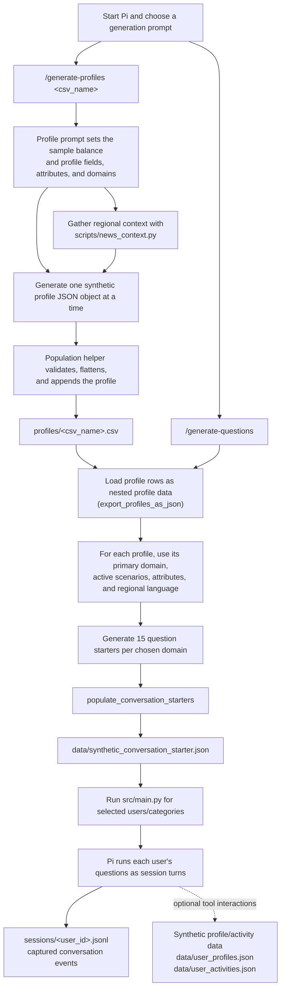
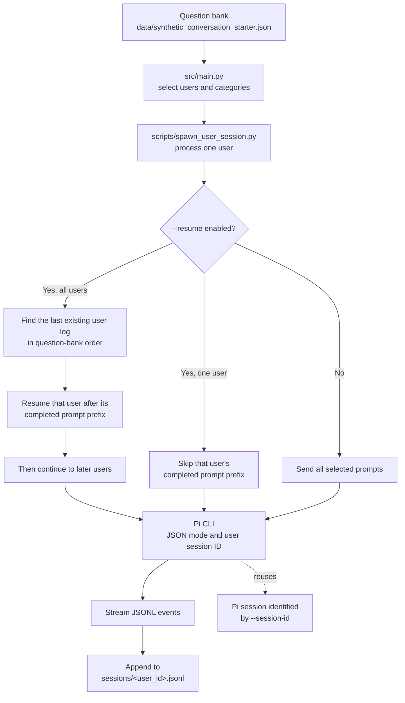

# Profile generation

Author: `Theophilus Owiti | MSEAI Carnegie Mellon University`

This repository contains agent instructions for creating synthetic user profiles, a Python news-context scraper to gather current regional context, and a helper for appending profile records to CSV files.

For an explanation of the source files and how the main workflows fit together, see the [source-code guide](docs/source-code-guide.md).

## Experimental profile generation

To generate synthetic profiles interactively, start Pi from the repository folder so it can load this project's `.pi` prompts and extensions:

```powershell
cd C:\Users\linco\Desktop\profile-generation
pi
```

In Pi, choose the model to use. This experiment used **Gemini 4 Argon**. Then enter the profile-generation slash command, replacing `users` with the CSV name you want:

```text
/generate-profiles users
```

The prompt generates synthetic profiles and directs the population helper to append them to `profiles/users.csv`. The slash-command menu may show `[-p]` as a shortcut; the command itself is `/generate-profiles` followed by the CSV name. To generate user conversation questions instead, use `/generate-questions`.

## Running and storing user sessions

The conversation runner starts sessions from the project folder with `src\main.py`. It reads the selected user's questions from `data\synthetic_conversation_starter.json`, starts one Pi process in JSON mode for that user, and passes the selected questions to Pi in category order. By default it runs all categories; select one user with `--uuid`, all users with `--all-users`, or limit the run with one or more `--category` options:

```powershell
uv run python src\main.py --uuid 101a4b2c-1101-4a01-8b01-000000000001
uv run python src\main.py --uuid 101a4b2c-1101-4a01-8b01-000000000001 --category school
uv run python src\main.py --all-users --category travel --category school
```

For each user, Pi's JSONL output is displayed in the terminal and appended to a separate file named `<user_id>.jsonl`. The default location is the repository's `sessions\` folder, for example `sessions\101a4b2c-1101-4a01-8b01-000000000001.jsonl`. Set `PI_CODING_AGENT_SESSION_DIR` or pass `--session-dir` to choose another folder. Repeated runs for a user append to that user's file; these files are the runner's captured JSONL output.

## Requirements and installation

- Python 3.15 (the required version is recorded in `.python-version` and `pyproject.toml`)
- [uv](https://docs.astral.sh/uv/getting-started/installation/) for environment and dependency management
- [Node.js and npm](https://nodejs.org/) to install and run the Pi CLI

From the repository root, install the project and its dependencies:

```powershell
uv sync
```

`uv.lock` pins the resolved dependencies. The news script uses Requests, Beautiful Soup, and Readability; `uv sync` installs them from `pyproject.toml`.

### Install Pi

Install the Pi CLI globally with npm (this does not add a `package.json` or `node_modules` to this repository):

```powershell
npm install --global @earendil-works/pi-coding-agent
```

Verify that Pi is available:

```powershell
pi --version
```

If PowerShell cannot find `pi`, make sure npm's global install directory is on your `PATH`, then open a new terminal. The conversation runner uses the `pi` command from `PATH`.

## How profile generation works

Profile generation is currently driven by agent instructions rather than an implemented Python generation command:

1. Gather relevant news context for each needed region and language with [`scripts/news_context.py`](scripts/news_context.py).
2. Follow the profile-generation prompt in [`.pi/prompts/generate-profiles.md`](.pi/prompts/generate-profiles.md) to create profiles in the specified JSON-object format.
3. Append each profile to a CSV under `profiles/` with the population helper described below.

The installed `profile-generation` command currently only prints a greeting; it does not generate profiles.

## News context script

Run commands from the repository root. For example, to retrieve one Swahili article for Kenya:

```powershell
uv run scripts/news_context.py --language sw --region Kenya --max-articles 1
```

The script prints progress messages while discovering and extracting candidate pages, then prints the formatted article context. It defaults to one output article. Use `--max-articles N` to request more.

Options:

- `--language`: required; `en`, `sw`, or `am`
- `--region`: optional region or country, such as `Kenya` or `East Africa`
- `--theme`: optional profile domain: `work`, `travel`, `school`, `shopping`, `family`, or `daily_planning`
- `--category`: optional news category, such as `business`, `politics`, `sports`, or `health`
- `--query`: optional search phrase that helps discover and rank articles; it does not strictly filter results
- `--strict-region`: skip extracted articles whose body does not mention the requested region
- `--max-articles`: number of articles to include; defaults to `1`

For example, focus on education news:

```powershell
uv run scripts/news_context.py --language sw --region Kenya --theme school
```

The configured publishers are Taifa Leo, The Standard (Kenya), and BBC. Publisher availability depends on language, and results should be checked for relevance to the requested region—particularly for North America, which has no dedicated source configured.

The module can also be called from Python:

```python
from scripts.news_context import fetch_news_context

result = fetch_news_context(
    language="sw",
    region="Kenya",
    theme="school",
    max_articles=1,
)
print(result["text"])                 # formatted full-text context
print(result["details"]["articles"])  # article metadata
```

## Run a question bank through Pi JSON mode

Use [src/main.py](src/main.py) to start the multi-turn runs from the command line. Select one user with `--uuid` or every user with `--all-users`. By default all categories run; pass `--category` to select a category (repeat it for more than one):

```powershell
uv run python src\main.py --uuid 101a4b2c-1101-4a01-8b01-000000000001
uv run python src\main.py --uuid 101a4b2c-1101-4a01-8b01-000000000001 --category school
uv run python src\main.py --all-users --category travel --category school
```

Each selected question is passed as a positional prompt to one Pi process in JSON mode, in category and question-bank order. The runner streams Pi's JSONL events to stdout and appends them to `sessions\<user_id>.jsonl`, one file per user. It prints the exact log path before each run. Set `GEMINI_API_KEY` before running. By default, logs are saved in the project `sessions` folder. Choose another folder with `--session-dir` or `PI_CODING_AGENT_SESSION_DIR`.

```powershell
uv run python src\main.py --uuid 101a4b2c-1101-4a01-8b01-000000000001 --category school --session-dir .\sessions
```

For one user, pass `--resume` to skip that user's completed prompt prefix and retry the remaining prompts. For `--all-users --resume`, the runner finds the last existing session log in question-bank order, resumes that user after its completed prompt prefix, then proceeds to later users. Earlier users are skipped. Use the same categories and session directory. To retry an earlier user's unfinished prompts, run that user with `--uuid <user-id> --resume`. Omit `--resume` to run every selected question again.

When running `--all-users`, a Pi process failure for one user is reported and the runner continues with the next user. After attempting all users, it reports the failures and exits with a non-zero status.

### Export sessions to a conversation CSV

Export every `sessions\*.jsonl` file into `data\multi-turn-conversation.csv`:

```powershell
uv run python data\export_multi_turn_conversations.py
```

The CSV has `user_request`, `agent_response`, and `tool_output` columns, with one row per user turn. The exporter extracts readable message and tool-result text rather than copying the JSONL event records; structured JSON inside tool results is rendered as key/value text. Use `--sessions-dir` or `--output` to override the defaults.

The same runner is available from Python. Pass categories to run only selected categories, or omit `categories` to process all six:

```python
from scripts.spawn_user_session import run_user_question_bank

questions_by_category = run_user_question_bank(
    "101a4b2c-1101-4a01-8b01-000000000001",
    categories=["school"],
)
```

The function reads `data/synthetic_conversation_starter.json`, passes all selected questions in one invocation, and returns the selected category-to-questions mapping. JSONL events are streamed to stdout and appended to the per-user session file; the API key is read from `GEMINI_API_KEY` by default. `run_category_questions(user_id, category)` remains available for running just one category.

## Repository agent files (`.pi/`)

- [`.pi/prompts/generate-profiles.md`](.pi/prompts/generate-profiles.md) defines the profile-generation workflow, regional sample balance, expected profile fields, and domain-specific guidance. It accepts a CSV name as its argument and targets `profiles/$1.csv`.
- [`.pi/synthetic-profile-population/SKILL.md`](.pi/synthetic-profile-population/SKILL.md) describes the CSV population helper workflow.
- [`.pi/synthetic-profile-population/references/formats.md`](.pi/synthetic-profile-population/references/formats.md) documents the expected profile object shape.
- [`.pi/synthetic-profile-population/scripts/populate.py`](.pi/synthetic-profile-population/scripts/populate.py) reads one nested JSON object from standard input, flattens nested dictionaries into underscore-separated CSV columns, and appends the row. It creates the file and headers if needed, and requires later objects to flatten to the same columns.

Append one profile JSON object per helper invocation:

```powershell
'{"profile_id":"00000000-0000-4000-8000-000000000001","identifiers":{"first_name":"Amina","last_name":"Example","email":"amina.0001+001@gmail.com","phone_number":null,"national_id":null,"national_id_format_note":"Synthetic mock format; not verified as an official identifier format.","country":"Kenya"},"personal_attributes":{"age":34,"location":"Nairobi, Kenya","occupation":"Teacher","education_level":"Bachelor degree","family_status":"Single","health_condition":"None"},"domain_metadata":{"primary_domain":"school","active_scenarios":["school","daily_planning"]}}' |
  uv run .pi/synthetic-profile-population/scripts/populate.py profiles\profiles.csv
```

The helper does not generate profile attributes or verify identities, but it fills null `phone_number` and `national_id` fields with random numbers following the project’s mock templates: Kenya ID 11 digits starting `40`; Tanzania ID 10 digits; Ethiopia ID 10 digits starting `392`; US state-ID-style mock 10 digits. Phone templates use `+254`, `+255`, `+251`, or `+1` plus the national digits described in the profile prompt. These are user-provided examples, not verified government or telephone allocations, and values are not guaranteed to be unassigned. The helper validates the schema and templates, including an exact integer for `age` and email addresses ending in `.com`. Addresses at provider or company domains may be deliverable or coincide with real mailboxes. The resulting columns include `identifiers_first_name`, `identifiers_national_id_format_note`, `personal_attributes_location`, and `domain_metadata_primary_domain`. Lists such as `active_scenarios` are stored as JSON text in a single cell. Invalid records are rejected with a non-zero exit status.
The UUID above is only an example; generate a new unique UUID for every row.

## Pi extension tools

The extensions in [`.pi/extensions/`](.pi/extensions/) register these tools with Pi:

### Conversation starters — `main-extensions.ts`

- **`populate_conversation_starters`** — Adds one or more questions to a user's categories in `data/synthetic_conversation_starter.json`. Provide `user_id` and any of `work`, `travel`, `school`, `shopping`, `family_interactions`, or `daily_planning` as arrays of question strings. Questions are appended to existing category entries; a missing user record is created.

### Profile export — `export-profiles.ts`

- **`export_profiles_as_json`** — Converts every row in a profile CSV into the nested profile JSON format and returns the complete array. `csv_path` is optional and defaults to `profiles/users.csv`. Required columns and values are validated; `age` becomes an integer and `active_scenarios` is parsed as a JSON string array.

### User profiles and activities — `user.ts`

- **`save_user_profile`** — Saves or updates a local profile in `data/user_profiles.json`. Requires `profile_id`, first and last names, and mobile phone; email, country, and preferred language are optional. The tool displays the submitted information and requires confirmation before writing.
- **`get_user_profile`** — Retrieves a saved profile by `profile_id`.
- **`record_user_activity`** — Saves a task, appointment, booking, reminder, or shopping item to `data/user_activities.json`. Requires `profile_id`, theme, activity type, and title; date/time, location, contact name, mobile phone, and notes are optional. It displays the submitted details and requires confirmation before writing.
- **`list_user_activities`** — Lists saved activities for a `profile_id`, optionally filtered by theme.

Supported activity themes are `work`, `travel`, `school`, `shopping`, `family`, and `daily_planning`; activity types are `booking`, `appointment`, `task`, `reminder`, and `shopping_item`. Profile and activity files are local JSON data under `data/`.

## OpenStreetMap MCP server

The project MCP configuration is in [`.pi/mcp.json`](.pi/mcp.json), and the stdio server is [`.pi/openstreetmap_mcp.py`](.pi/openstreetmap_mcp.py). It provides `search_places` and `reverse_geocode` tools using a Nominatim-compatible endpoint. The server is explicitly enabled with direct tool exposure, so Pi connects it when a session starts and makes both tools directly available. The configuration defaults to a local Nominatim instance at `http://localhost:8080`; that service must also be running. Set `NOMINATIM_URL` in the configuration to another endpoint you are authorized to use.

`search_places` accepts a `query` and optional `limit`; `reverse_geocode` accepts `latitude` and `longitude`. Pass only these tool arguments—do not pass an `attribution` argument. Both tools include OpenStreetMap attribution in their returned data.

Use the tools only for individual, user-requested lookups. Do not use autocomplete, bulk or systematic queries, or submit personal or confidential data. Requests are limited to one per second. Returned map data includes OpenStreetMap attribution; review the [Nominatim usage policy](https://operations.osmfoundation.org/policies/nominatim/) before configuring a public endpoint.

## Project layout

```text
.pi/
  prompts/                         Agent prompt for profile generation
  mcp.json                         OpenStreetMap MCP client configuration
  openstreetmap_mcp.py             OpenStreetMap MCP server
  synthetic-profile-population/    Agent skill, format reference, CSV helper
data/
  synthetic_conversation_starter.json  Generated question bank
  export_multi_turn_conversations.py   Session JSONL-to-CSV exporter
  multi-turn-conversation.csv          Exported conversation data
profiles/                          Generated profile CSV files
sessions/                          Per-user Pi JSONL session logs
scripts/
  news_context.py                  News discovery and full-text extraction
src/profile_generation/            Python package entry point
tests/                             Focused Python tests
pyproject.toml                     Project metadata and dependencies
uv.lock                            Locked dependency versions
```

## Environment variables

Set these in PowerShell from the repository root before running conversations:

```powershell
$env:GEMINI_API_KEY = "your-gemini-api-key"
$env:PI_CODING_AGENT_SESSION_DIR = "$($PWD.Path)\sessions"
$env:PI_MAX_TURNS = "50"

uv run python src\main.py --uuid 101a4b2c-1101-4a01-8b01-000000000001
```

- `GEMINI_API_KEY` is required for Gemini model requests.
- `PI_CODING_AGENT_SESSION_DIR` sets where per-user JSONL conversation files are saved. The command above uses the repository's `sessions` folder.
- `PI_MAX_TURNS` sets Pi's maximum turns to `50`.

These settings apply to the current PowerShell window. Set them again in a new window before running the command.

## Profile-to-session generation architecture



These are separate steps: `/generate-profiles` creates the profile CSV; `/generate-questions` uses those profiles to create the question bank; running `src/main.py` turns the selected questions into saved Pi sessions. Tool-backed profile or activity data is written only when a conversation uses those tools.

## Conversation session generation architecture



With `--all-users --resume`, the last existing user's session in question-bank order resumes from its completed prompt prefix; earlier users are left untouched. Use `--uuid <user-id> --resume` to retry an earlier incomplete user session.
